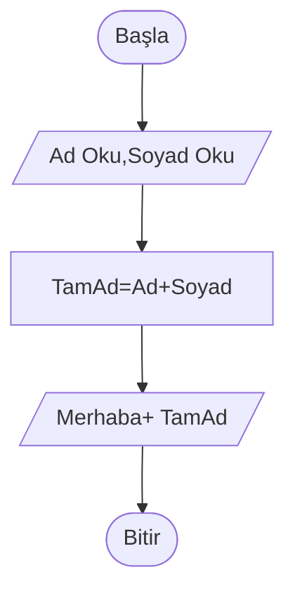

# kod_asistanim
proje yazarı Muhammed Çifçi
#proje adı: Kod-Asistan v0.1
##proje amacı:Günlük sorunlara çözüm 
kritik eşik sözde kodu:
adım1:Başla
adım2:saat oku
adım3:yükseklik oku
adım4:h>50 ise adım 7'e değilse adım 5'ye git
adım5:saat=saat+1
adım6:Adım 2'ye git
adım7:Kapakları aç
adım8:Tahliye saati ve kritik su miktarını ekrana yazdır
adım9:Bitir
##Kaynakça
##meb_programlama_temelleri_ders_kitabı
##7.Uygulama: Kod-Asistan Basit Kayıt Akışı

